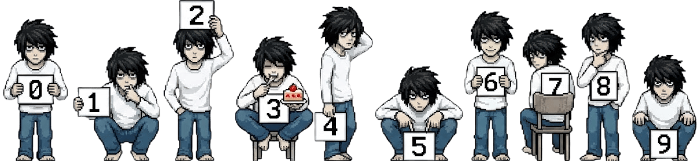
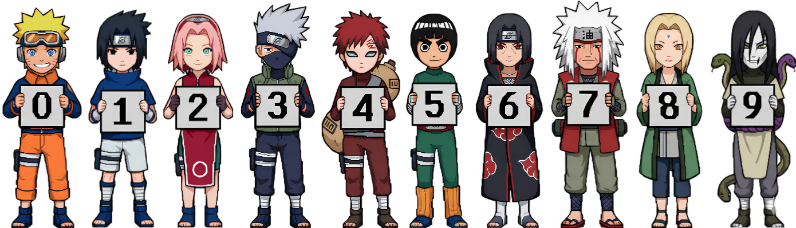
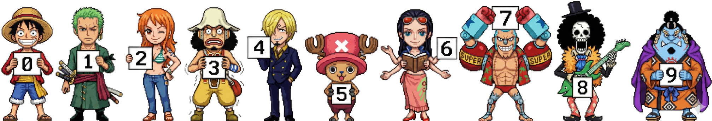
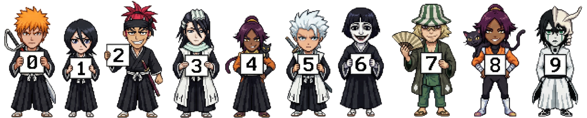
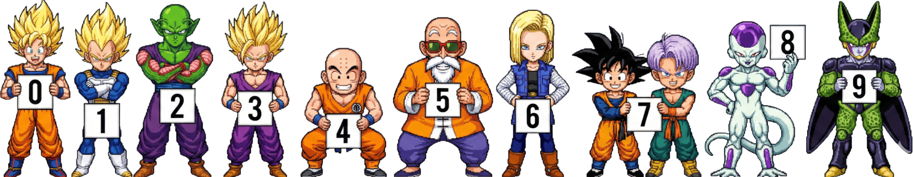
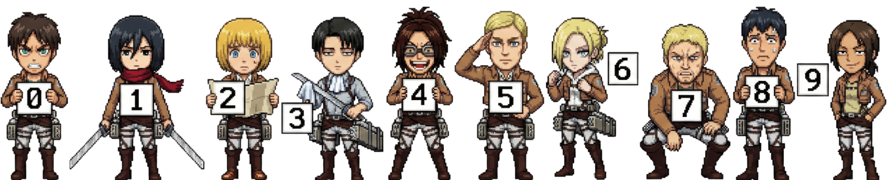
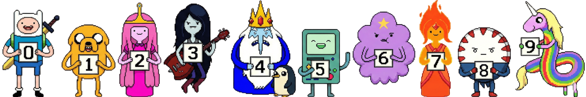
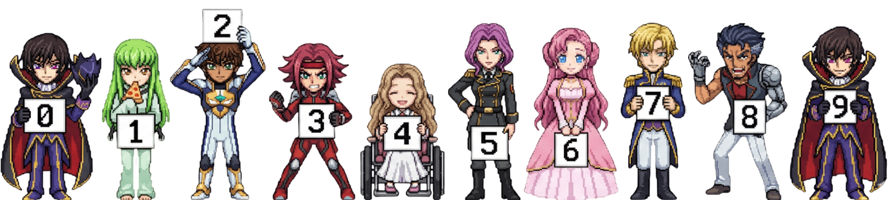
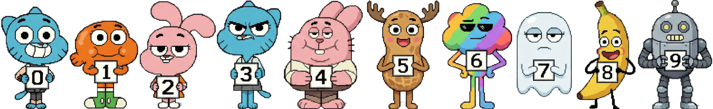

# Anime Counter 🌸

<p align="center">
  
</p>

<p align="center">
  <strong>Ultra-fast, zero-maintenance, and serverless visitor counter badge for GitHub profiles and websites.</strong>
</p>

<p align="center">
  <a href="./docs/i18n/README_TR.md">Türkçe</a> •
  <a href="./docs/i18n/README_JA.md">日本語</a> •
  <a href="./docs/i18n/README_ZH.md">中文</a>
</p>

---

<details>
<summary><strong>🎨 Click to view all Themes (0-9 Showcase Gallery)</strong></summary>
<br>

### Death Note (L)


### Naruto


### One Piece


### Bleach


### Dragonball


### Attack on Titan (AOT)


### Adventure Time


### Code Geass


### Gumball


### Monster


</details>

---

## Overview
**Anime Counter** is a high-performance profile view counter built with **TypeScript**, **Hono**, and **Cloudflare Workers**. It generates dynamic flat SVG badges and retro anime sprite counters with sub-millisecond render times and zero operational cost.

## Key Highlights
- **Atomic & Resilient Counting:** Supports Cloudflare D1 as well as seamless backward compatibility with Cloudflare KV. Never loses count under concurrent traffic.
- **Embedded Sprites:** All character sprites are bundled into the Worker at build time (`0` storage I/O, no R2 or external network latency).
- **Edge Caching:** Static and deterministic preview requests are cached across Cloudflare's 300+ edge locations.
- **XSS-Safe:** Strict parameter sanitization and hex/CSS color validation.

## Quick Start
Add the badge to your GitHub profile `README.md`:

```markdown
<!-- Flat Theme (Default) -->


<!-- Death Note (L) Sprite Theme -->


<!-- Naruto Sprite Theme -->

```

## URL Parameters
| Parameter | Description | Default | Example |
| :--- | :--- | :--- | :--- |
| `theme` | Badge theme name (`flat` or anime theme) | `flat` | `theme=l` |
| `scale` | Size multiplier (`0.1` to `10`) | `1.0` | `scale=1.2` |
| `length` | Minimum number of digits for image themes | `7` | `length=8` |
| `pixelated` | Pixelated retro rendering (`1` or `0`) | `1` | `pixelated=0` |
| `num` | Static number override (bypasses database) | None | `num=1337` |
| `icon` | Flat badge prefix icon or emoji | None | `icon=🌸` |
| `color` | Flat badge text color (hex without #) | `c9d1d9` | `color=fbcfe8` |
| `bg` | Flat badge background color (hex) | `21262d` | `bg=2d1b2c` |
| `stroke` | Flat badge border color (hex) | `30363d` | `stroke=f472b6` |
| `animation` | Animation style (`pulse`, `fade`, `slide`, `none`) | `none` | `animation=pulse` |

## Self-Hosting (Deploy to Cloudflare)
1. **Clone & install:**
   ```bash
   git clone https://github.com/lulushuz/Anime-Counter.git
   cd Anime-Counter
   npm install
   ```
2. **Deploy to your Cloudflare account:**
   ```bash
   npx wrangler deploy
   ```

## Translations
- 🇹🇷 [Türkçe Dokümantasyon](./docs/i18n/README_TR.md)
- 🇯🇵 [日本語ドキュメント](./docs/i18n/README_JA.md)
- 🇨🇳 [中文简体文档](./docs/i18n/README_ZH.md)

---

## 📜 License
Licensed under the [MIT License](LICENSE). Made with 🌸 by [Lulushu](https://github.com/lulushuz).
