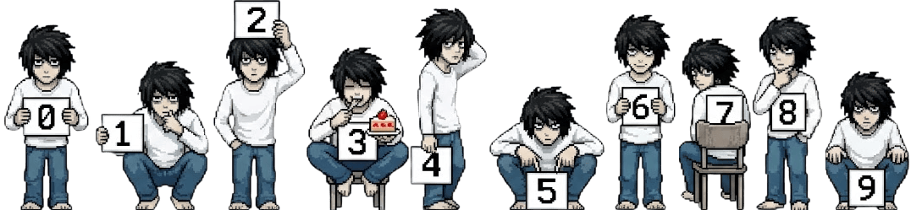
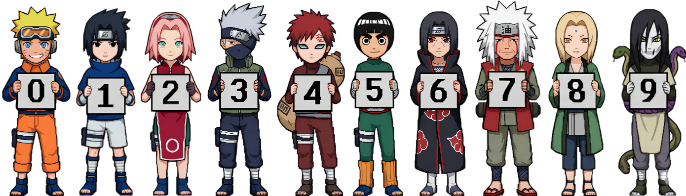
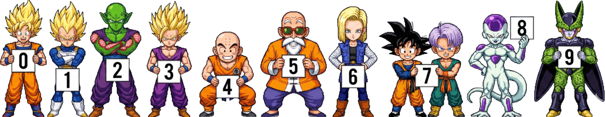
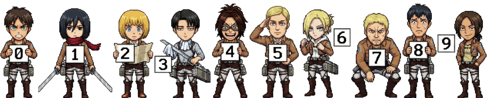
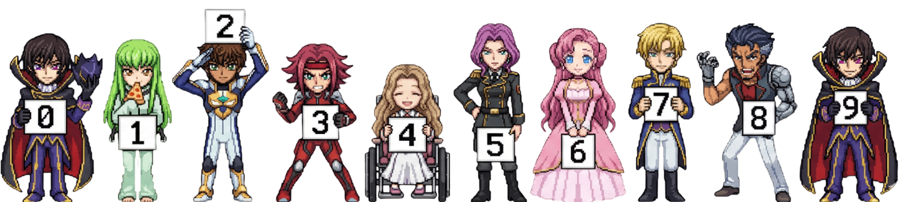

<h1 align="center">Anime Counter</h1>

<p align="center">
  
</p>

<p align="center">
  <strong>GitHubプロフィールやウェブサイト向けの超高速・メンテナンスフリーなサーバーレス訪問者カウンターバッジ。</strong>
</p>

<p align="center">
  <a href="../../README.md">English</a> •
  <a href="./README_TR.md">Türkçe</a> •
  <a href="./README_ZH.md">中文</a>
</p>

---

<details>
<summary><strong>すべてのテーマを表示（0-9ギャラリープレビュー）</strong></summary>
<br>

### Death Note (L)


### Naruto


### One Piece


### Bleach


### Dragonball


### Attack on Titan (AOT)


### Adventure Time


### Code Geass


### Gumball


### Monster


</details>

---

## 概要
**Anime Counter** は、**TypeScript**、**Hono**、および **Cloudflare Workers** で構築された高性能プロフィールアクセスカウンターです。モダンなフラットSVGバッジやアニメドット絵スプライトカウンターをサブミリ秒で生成し、サーバー運用コストゼロで稼働します。

## 主な特徴
- **安全で原子的（Atomic）なカウント:** Cloudflare D1 および従来の Cloudflare KV の両方に完全互換。高トラフィック時でもカウントデータの欠損やリセットを防ぎます。
- **スプライト埋め込み:** すべてのキャラクタースプライトはビルド時に Worker に直接バンドルされます（外部 I/O や追加ネットワーク遅延ゼロ）。
- **エッジキャッシュ:** 静的プレビューや確定的なリクエストは、世界300以上の Cloudflare エッジロケーションで高速キャッシュされます。
- **XSS保護:** パラメータの厳格なサニタイズとカラーコードの検証。

## クイックスタート
GitHub プロフィールの `README.md` に追加してください:

```markdown
<!-- Flat テーマ (デフォルト) -->


<!-- Death Note (L) スプライトテーマ -->


<!-- Naruto スプライトテーマ -->

```

## パラメータ一覧
| パラメータ | 説明 | デフォルト | 例 |
| :--- | :--- | :--- | :--- |
| `theme` | カウンターテーマ (`flat`, `l`, `naruto`, `onepiece`, `bleach`, `dragonball`, `aot`, `adventuretime`, `codegeass`, `gumball`, `monster`) | `flat` | `theme=l` |
| `scale` | 表示倍率 (`0.1` - `10`) | `1.0` | `scale=1.2` |
| `length` | 画像テーマの最小桁数 | `7` | `length=8` |
| `pixelated` | レトロドット絵表示 (`1` または `0`) | `1` | `pixelated=0` |
| `num` | データベースをバイパスして固定数値を表示 | なし | `num=1337` |
| `icon` | プレフィックスアイコンまたはテキスト (`flat` テーマのみ) | なし | `icon=views` |
| `color` | テキスト色 (#なし HEX) | `c9d1d9` | `color=fbcfe8` |
| `bg` | 背景色 (HEX) | `21262d` | `bg=2d1b2c` |
| `stroke` | 枠線色 (HEX) | `30363d` | `stroke=f472b6` |
| `animation` | バッジアニメーション (`pulse`, `fade`, `slide`, `none`) | `none` | `animation=pulse` |

## ローカル開発環境

```bash
# 依存関係のインストール
npm install

# テーマのビルド
npm run build:themes

# 開発サーバーの起動
npm run dev

# テスト実行
npm test
```

## デプロイ

```bash
npm run deploy
```

---
Made by [Lulushu](https://github.com/lulushuz)
