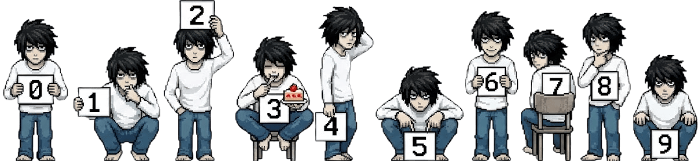
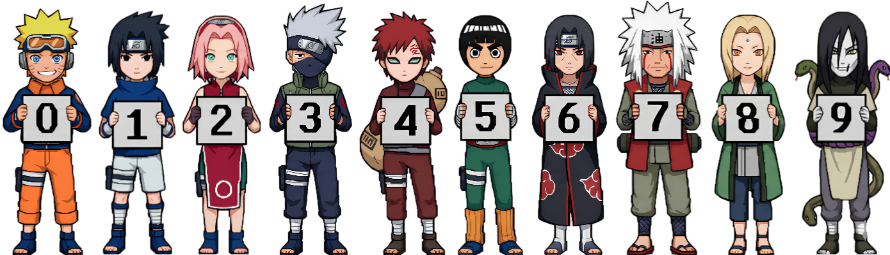
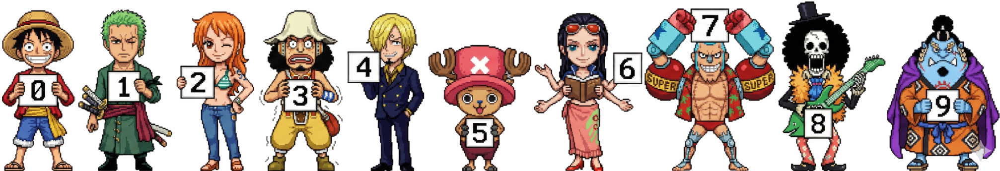
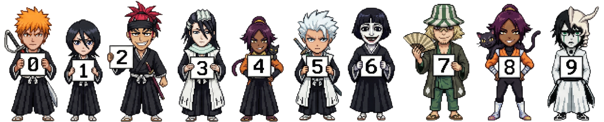
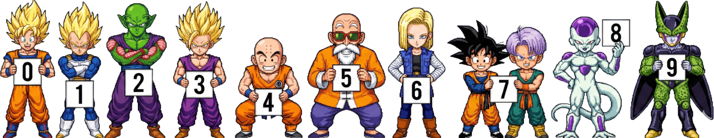
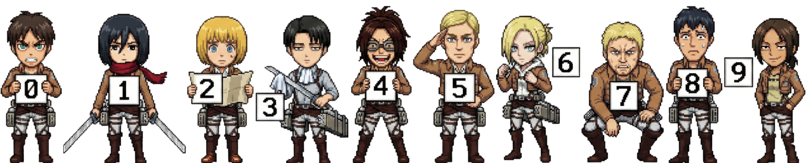
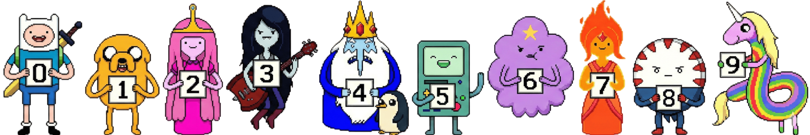
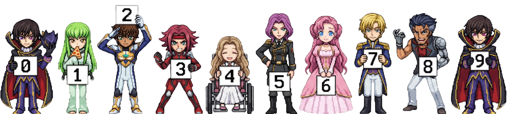
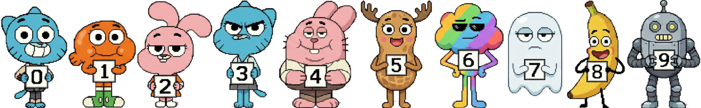

<h1 align="center">Anime Counter</h1>

<p align="center">
  
</p>

<p align="center">
  <strong>GitHub profilleri ve web siteleri için ultra hızlı, bakım gerektirmeyen, sunucusuz ziyaretçi sayacı rozeti.</strong>
</p>

<p align="center">
  <a href="../../README.md">English</a> •
  <a href="./README_JA.md">日本語</a> •
  <a href="./README_ZH.md">中文</a>
</p>

---

<details>
<summary><strong>Tüm Temaları Görüntüle (0-9 Galeri Önizlemesi)</strong></summary>
<br>

### Death Note (L)


### Naruto


### One Piece


### Bleach


### Dragonball


### Attack on Titan (AOT)


### Adventure Time


### Code Geass


### Gumball


### Monster


</details>

---

## Genel Bakış
**Anime Counter**, **TypeScript**, **Hono** ve **Cloudflare Workers** ile geliştirilmiş yüksek performanslı bir profil sayaç servisidir. Dinamik modern düz (flat) SVG rozetleri ve anime piksel sprite animasyonlu sayaçlarını milisaniyenin altında render eder. Sıfır sunucu maliyeti ile çalışır.

## Öne Çıkan Özellikler
- **Atomik ve Güvenli Sayaç:** Cloudflare D1 ve eski Cloudflare KV altyapısını tam uyumlu destekler. Yoğun trafikte sayaç sıfırlanmaz veya veri kaybolmaz.
- **Dahili (Embedded) Sprite'lar:** Tüm anime karakter sprite görselleri build aşamasında Worker içerisine gömülür (0 harici I/O ve sıfır harici ağ gecikmesi).
- **Edge Cache:** Statik ve önizleme istekleri Cloudflare'in 300'den fazla küresel edge noktasında akıllıca önbelleğe alınır.
- **XSS Korumalı:** Sıkı parametre temizleme ve renk sanitizasyonu.

## Hızlı Başlangıç
Rozeti GitHub profilinizin `README.md` dosyasına ekleyin:

```markdown
<!-- Flat Tema (Varsayılan) -->


<!-- Death Note (L) Teması -->


<!-- Naruto Teması -->

```

## Parametreler
| Parametre | Açıklama | Varsayılan | Örnek |
| :--- | :--- | :--- | :--- |
| `theme` | Sayaç teması (`flat`, `l`, `naruto`, `onepiece`, `bleach`, `dragonball`, `aot`, `adventuretime`, `codegeass`, `gumball`, `monster`) | `flat` | `theme=l` |
| `scale` | Boyut çarpanı (`0.1` - `10`) | `1.0` | `scale=1.2` |
| `length` | Görsel temalar için minimum basamak sayısı | `7` | `length=8` |
| `pixelated` | Retro pikselli render modu (`1` veya `0`) | `1` | `pixelated=0` |
| `num` | Veritabanını atlayarak sabit sayı gösterir | Yok | `num=1337` |
| `icon` | Ön ek ikon veya metin (Yalnızca `flat` tema için) | Yok | `icon=views` |
| `color` | Yazı rengi (# olmadan hex kodu) | `c9d1d9` | `color=fbcfe8` |
| `bg` | Arka plan rengi (hex kodu) | `21262d` | `bg=2d1b2c` |
| `stroke` | Çerçeve rengi (hex kodu) | `30363d` | `stroke=f472b6` |
| `animation` | Rozet animasyonu (`pulse`, `fade`, `slide`, `none`) | `none` | `animation=pulse` |

## Yerel Geliştirme

```bash
# Bağımlılıkları yükleyin
npm install

# Temaları derleyin
npm run build:themes

# Yerel geliştirici sunucusunu başlatın
npm run dev

# Testleri çalıştırın
npm test
```

## Yayınlama (Deploy)

```bash
npm run deploy
```

---
Made by [Lulushu](https://github.com/lulushuz)
