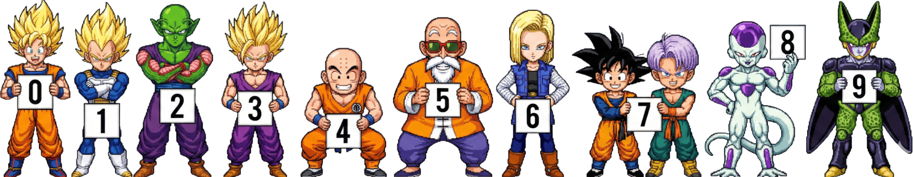

<h1 align="center">Anime Counter</h1>

<p align="center">
  
</p>

<p align="center">
  <strong>专为 GitHub 个人主页与网站打造的超高速、免维护、无服务器访客计数器徽章。</strong>
</p>

<p align="center">
  <a href="../../README.md">English</a> •
  <a href="./README_TR.md">Türkçe</a> •
  <a href="./README_JA.md">日本語</a>
</p>

---

<details>
<summary><strong>点击查看所有主题（0-9 图库预览）</strong></summary>
<br>

### Death Note (L)


### Naruto


### One Piece


### Bleach


### Dragonball


### Attack on Titan (AOT)


### Adventure Time


### Code Geass


### Gumball


### Monster


</details>

---

## 概述
**Anime Counter** 是一个基于 **TypeScript**、**Hono** 与 **Cloudflare Workers** 构建的高性能主页访客计数服务。它能在亚毫秒级时间内生成精美的扁平化 SVG 徽章与复古像素动漫精灵图计数器，零维护且完全免费运行。

## 核心特性
- **原子性与高可靠计数:** 支持 Cloudflare D1 以及对既有 Cloudflare KV 数据的无缝向后兼容。高并发访问下计数永不归零或丢失。
- **内嵌精灵图资源:** 所有动漫角色精灵图在构建时直接打包进 Worker（0 外部存储 I/O，无额外网络延迟）。
- **边缘智能缓存:** 静态与确定性预览请求在 Cloudflare 全球 300+ 边缘节点极速缓存。
- **安全防范:** 具备严格的 URL 参数净化与 XSS / 十六进制色彩校验。

## 快速上手
将计数器徽章添加到你的 GitHub 主页 `README.md` 中：

```markdown
<!-- Flat 扁平主题 (默认) -->


<!-- Death Note (L) 像素主题 -->


<!-- 火影忍者 (Naruto) 像素主题 -->

```

## 参数说明
| 参数 | 说明 | 默认值 | 示例 |
| :--- | :--- | :--- | :--- |
| `theme` | 计数器主题 (`flat`, `l`, `naruto`, `onepiece`, `bleach`, `dragonball`, `aot`, `adventuretime`, `codegeass`, `gumball`, `monster`) | `flat` | `theme=l` |
| `scale` | 缩放比例 (`0.1` - `10`) | `1.0` | `scale=1.2` |
| `length` | 最小显示位数 | `7` | `length=8` |
| `pixelated` | 像素化清晰模式 (`1` 或 `0`) | `1` | `pixelated=0` |
| `num` | 跳过数据库并直接显示静态数值 | 无 | `num=1337` |
| `icon` | 前缀图标或文本（仅适用于 `flat` 主题） | 无 | `icon=views` |
| `color` | 文本颜色 (不含 # 的十六进制) | `c9d1d9` | `color=fbcfe8` |
| `bg` | 背景颜色 (十六进制) | `21262d` | `bg=2d1b2c` |
| `stroke` | 边框颜色 (十六进制) | `30363d` | `stroke=f472b6` |
| `animation` | 徽章动画 (`pulse`, `fade`, `slide`, `none`) | `none` | `animation=pulse` |

## 本地开发

```bash
# 安装依赖
npm install

# 构建主题资源
npm run build:themes

# 启动本地开发服务
npm run dev

# 运行单元测试
npm test
```

## 部署到 Cloudflare

```bash
npm run deploy
```

---
Made by [Lulushu](https://github.com/lulushuz)
